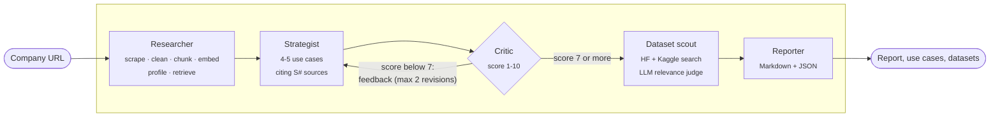
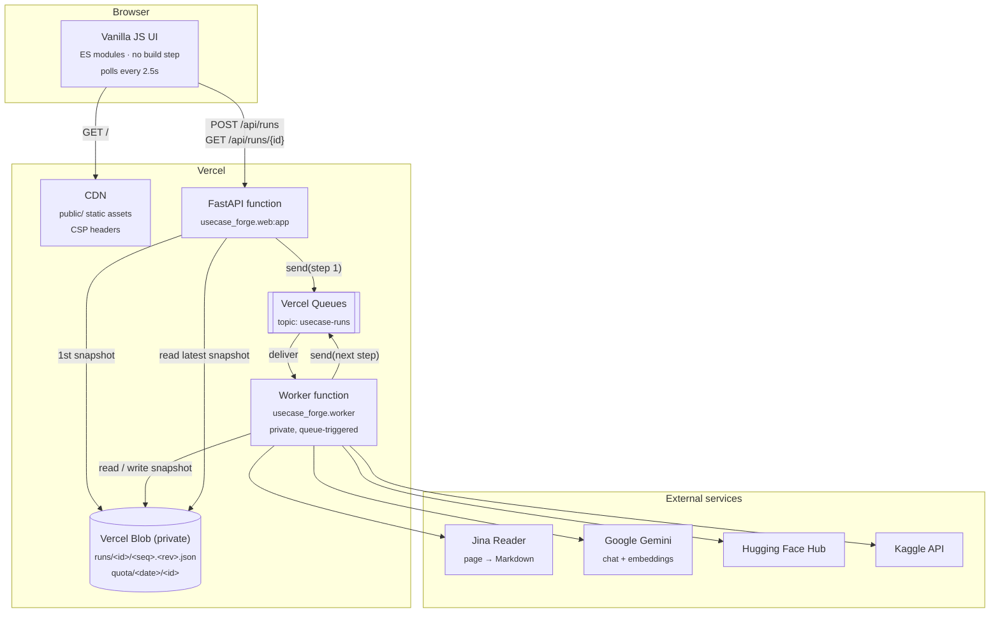
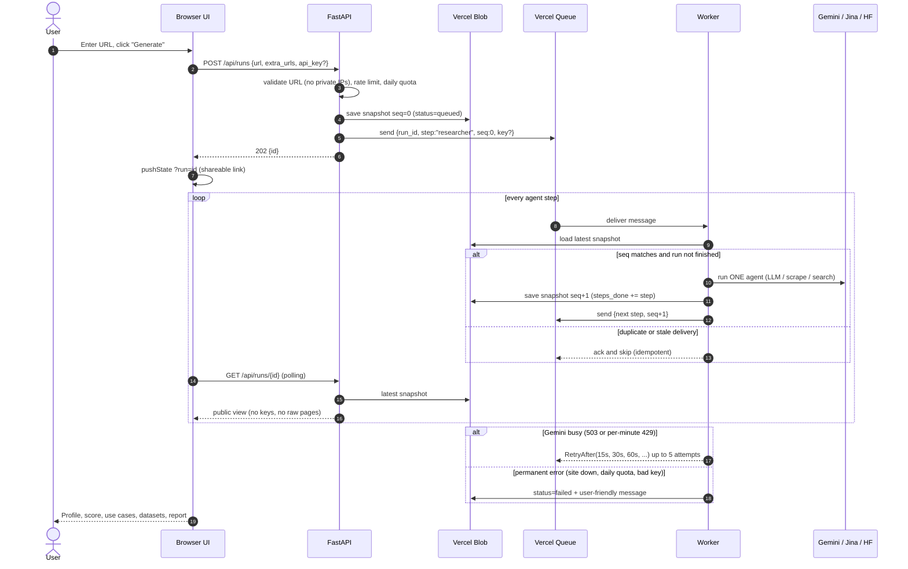
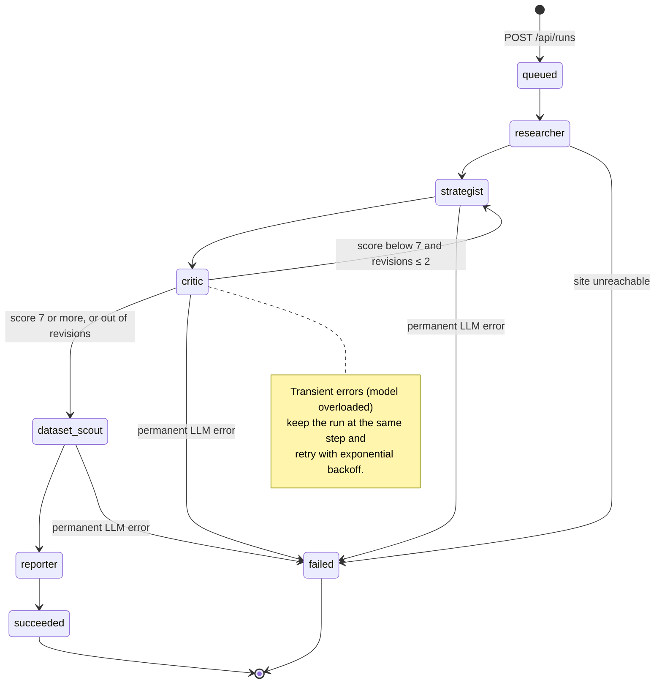
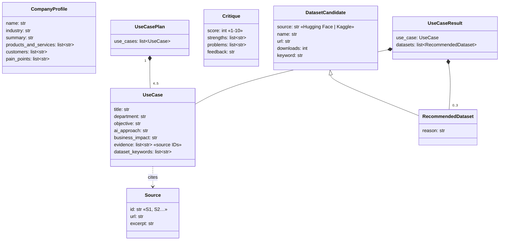

<div align="center">

# UseCaseForge

### Five AI agents turn any company website into grounded GenAI/ML use cases, each with public datasets to prototype it.

[](https://usecase-forge.vercel.app)
[](https://github.com/badalsharma9929/usecase-forge/actions/workflows/ci.yml)
[](https://www.python.org/)
[](LICENSE)

**[Live demo](https://usecase-forge.vercel.app)** · [How it works](#-how-it-works) · [Architecture](#-system-architecture) · [Tech stack](#-tech-stack) · [Run locally](#-run-locally) · [Design docs](docs/)

</div>

---

## Table of contents

1. [What it does](#-what-it-does)
2. [Why it's different](#-why-its-different)
3. [Sample output](#-sample-output)
4. [How it works](#-how-it-works) (the five agents)
5. [System architecture](#-system-architecture)
6. [Request lifecycle](#-request-lifecycle)
7. [Agent workflow (state machine)](#-agent-workflow-state-machine)
8. [Data model](#-data-model)
9. [Tech stack](#-tech-stack)
10. [Engineering decisions](#-engineering-decisions)
11. [Security and guardrails](#-security-and-guardrails)
12. [API reference](#-api-reference)
13. [Project structure](#-project-structure)
14. [Run locally](#-run-locally)
15. [Deploy to Vercel](#-deploy-to-vercel)
16. [Configuration](#-configuration)
17. [Testing](#-testing)
18. [Limitations and roadmap](#-limitations-and-roadmap)
19. [Project history](#-project-history)

---

## What it does

You paste a company's website. About five minutes later you get:

| Output | Details |
|---|---|
| **Company profile** | Name, industry, products, customers and likely pain points, taken from the site itself |
| **4-5 AI use cases** | Each has an owning department, objective, concrete AI technique and a measurable business KPI |
| **Evidence** | Every use case cites the exact passages of the website it is based on (`[S3]`, `[S11]` …) |
| **Quality score** | An AI critic scores the plan from 1 to 10 and sends weak plans back for revision |
| **Datasets** | Public Hugging Face and Kaggle datasets to prototype each idea, checked for relevance |
| **Report** | Downloadable Markdown and JSON, plus a shareable link to the results |

**Who it's for:** AI consultants preparing a client pitch, product teams scoping AI features, students looking for realistic project ideas, and founders deciding where AI pays off first.

---

## Why it's different

Most "AI use case generator" demos send one prompt to an LLM and return generic ideas ("Use a chatbot for customer support!"). UseCaseForge is built to avoid that:

| Problem with single-prompt generators | How UseCaseForge solves it |
|---|---|
| Generic ideas any company could use | Retrieval (RAG) feeds the strategist the company's **own website content**, and the critic penalises generic plans |
| Hallucinated claims | Every use case must cite source IDs; **citations to passages that weren't retrieved are removed in code** |
| No quality control | A **critic agent** scores against a rubric and loops weak plans back (up to 2 revisions) |
| "Now find data" is left to you | A **dataset scout** searches Hugging Face and Kaggle, then an LLM judge keeps only datasets that fit |
| Brittle text parsing | Every LLM answer is a **typed Pydantic model** (structured output), not text split on `**` markers |
| Demo-only, times out in production | A **queue-based serverless design**: each agent runs as its own job, with retries and resumable state |

---

## Sample output

A real run on **byjus.com**, produced on the live deployment:

> **BYJU'S** · EdTech · Critic score **10/10** (approved on the first draft)
>
> | # | Use case | Department | Evidence | Datasets found |
> |---|---|---|---|---|
> | 1 | AI-powered demo-session lead scoring and counselor assignment | Sales & Marketing | S1, S2 | `shaypal5/leadforge-lead-scoring-v1`, `shawhin/lead-scoring-x` |
> | 2 | Automated offline-to-online class routing and instant doubt resolution | Customer Operations | S2, S3, S14 | `aisingapore/NLU-Question-Answering` |
> | 3 | Adaptive knowledge graph and dynamic remedial pathway engine | Product Development | S11, S12, S13 | `DElmazi/Student_Performance`, `bihungba1101/slam-en-es-knowledge-tracing` |
> | 4 | Real-time two-teacher live-class assistant and dynamic quiz generator | Curriculum & Academics | S3, S7, S13 | `derek-thomas/squad-v1.1-t5-question-generation` |

Each use case in the full report has the following shape:

```text
## 3. Adaptive Knowledge Graph & Dynamic Remedial Pathway Engine
- Department:      Product Development
- Objective:       Detect learning gaps from quiz errors and generate personalised remedial pathways.
- AI approach:     Graph Neural Networks + Deep Knowledge Tracing on quiz error logs, watch times
                   and concept-dependency tags.
- Business impact: Raise daily engagement beyond the 71-minute baseline; +25% concept retention.
- Evidence:        [S11], [S12], [S13]   <- passages from byjus.com, listed under Sources
Datasets to prototype with:
- DElmazi/Student_Performance (Hugging Face): student performance data for outcome modelling
- bihungba1101/slam-en-es-knowledge-tracing (Hugging Face): interaction logs for knowledge tracing
```

---

## How it works



| Agent | Input | What it does | Output |
|---|---|---|---|
| **1. Researcher** | URL (+ up to 3 extra pages) | Fetches pages through Jina Reader, strips images, links and URLs (on byjus.com, about two-thirds of the page was navigation noise), splits text into overlapping 900-character chunks, embeds them with Gemini, writes a structured `CompanyProfile`, then retrieves the most relevant chunks for the profile's products, pain points and customers | `profile`, `sources[S1…Sn]` |
| **2. Strategist** | Profile + retrieved sources (+ critic feedback on revisions) | Drafts 4-5 use cases across at least 3 departments. Each must name a concrete technique, a KPI, and the source IDs that support it. **Invalid citations are removed in code.** | `UseCasePlan` |
| **3. Critic** | Profile, sources, plan | Scores against a weighted rubric: **specificity** (most important), grounding, feasibility, coverage, impact. Generic plans are capped at 6. | `Critique{score, strengths, problems, feedback}` |
| **4. Dataset scout** | Each use case's keywords | Searches Hugging Face (and Kaggle when configured). If a long phrase finds nothing, it retries with shorter word pairs. An LLM then judges every candidate and keeps the relevant ones, sorted by downloads. | Up to 3 datasets per use case |
| **5. Reporter** | Final state | Assembles the Markdown report and the list of cited sources. No LLM call. | `report.md` |

The routing after the critic is plain code, not an LLM decision, so the loop always ends:

```python
def after_critic(state, deps):
    if state["critique"].score >= deps.settings.approval_score:   # 7 by default
        return "dataset_scout"
    if state["revisions"] > deps.settings.max_revisions:          # 2 by default
        return "dataset_scout"   # out of budget: ship the best effort
    return "strategist"
```

---

## System architecture



**Key idea: one agent step per queue message.** A full run takes several minutes because it waits on the LLM, which is too long for one serverless request. Instead, the API saves the run's starting state and queues the first step. The worker runs exactly one agent, saves the new state, and queues the next step. The browser simply reads the latest saved state.

The same agents also run **in a single process** with LangGraph for the CLI, local development and tests. `graph.py` defines the control flow once, and both runners use it.

---

## Request lifecycle



---

## Agent workflow (state machine)



---

## Data model

Every LLM call returns one of these Pydantic models, so no agent ever parses free text.



**Run snapshot** (stored as JSON in Blob; a new object on every change):

```jsonc
{
  "id": "dc3201a2…",            // uuid4 hex: unguessable, used as the share link
  "seq": 4, "rev": 0,           // seq = completed steps, rev = notes within a step
  "status": "running",          // queued | running | succeeded | failed
  "step": "dataset_scout",      // the step that runs next
  "steps_done": ["researcher", "strategist", "critic", "strategist"],
  "key_source": "server",       // server | own (the key itself is never stored)
  "notice": null, "error": null,
  "state": { "url": "…", "profile": {…}, "sources": […], "plan": {…},
             "critique": {…}, "scores": [5, 8], "results": […], "report": "…", "log": […] }
}
```

---

## Tech stack

| Layer | Technology | Why this choice |
|---|---|---|
| **Agent orchestration** | [LangGraph](https://langchain-ai.github.io/langgraph/) `StateGraph` | Typed shared state, conditional edges for the critic loop, streaming progress |
| **LLM framework** | [LangChain Core](https://python.langchain.com/) | `with_structured_output`, `with_fallbacks`, vector store abstraction |
| **LLM** | Google **Gemini 3.8 Flash** (fallback **Gemini 3.5 Flash**) | Fast, cheap, has a free tier, supports structured output |
| **Embeddings** | `gemini-embedding-001` | Semantic retrieval over the scraped pages |
| **Vector store** | LangChain `InMemoryVectorStore` + NumPy | A run indexes only one site, so no database is needed |
| **Structured output** | **Pydantic v2** | Every agent output is a validated type |
| **Web scraping** | [Jina Reader](https://jina.ai/reader/) + custom Markdown cleaner | Turns any page, including JS-rendered ones, into clean text |
| **Dataset search** | `huggingface_hub` · `kaggle` API | Real public datasets; Kaggle is optional |
| **Backend API** | **FastAPI** | Async, typed request models, automatic OpenAPI |
| **Background jobs** | **Vercel Queues** (Python SDK) | At-least-once delivery, retries, private consumer function |
| **State storage** | **Vercel Blob** (private store) | Immutable JSON snapshots per run step |
| **Secrets** | `cryptography` (Fernet) | Encrypts visitors' own API keys inside queue messages |
| **Frontend** | Vanilla JS (ES modules) + CSS custom properties | No build step, fast load, works under a strict CSP |
| **Hosting** | **Vercel** (Fluid compute, Python 3.12, `uv`) | Git-push deploys, CDN, serverless functions |
| **Testing** | **pytest** + FastAPI `TestClient` + fake LLM | 42 offline tests; no keys or network needed |
| **CI** | GitHub Actions | Runs the test suite on every push |
| **Alt hosting** | Docker | Single-container self-hosting |

---

## Engineering decisions

<details>
<summary><b>1. Why one agent step per queue message instead of one long job?</b></summary>

A run waits on 7-11 LLM calls. With Gemini's free tier that can take 5-15 minutes, which is longer than a single serverless invocation should run. Splitting by agent means:

- every invocation is short (one agent);
- a crash or timeout repeats **one step**, not the whole run;
- progress is saved after every step, so the UI shows real progress and the run survives restarts.

Retrieval runs **once, in the researcher**, and the retrieved sources are saved in state. Later steps therefore don't need the vector index, which only exists in memory.
</details>

<details>
<summary><b>2. How are duplicate queue deliveries handled?</b></summary>

Queues deliver *at least once*. Every message carries the `seq` of the snapshot it expects. The worker loads the latest snapshot and skips the message if `seq` doesn't match, the run is finished, or the step differs. Reprocessing a message is therefore harmless (`tests/test_runs.py::test_duplicate_delivery_is_ignored`).
</details>

<details>
<summary><b>3. Why immutable snapshots instead of overwriting one file?</b></summary>

Each change writes a new object, `runs/<id>/<seq>.<rev>.json`, and readers take the highest name. Nothing is ever overwritten, so a cached read can't return stale progress, and each run keeps a full audit trail of its steps.
</details>

<details>
<summary><b>4. How are hallucinated citations prevented?</b></summary>

The strategist only sees passages labelled `[S1]…[Sn]`. After it answers, code keeps only the IDs that were actually retrieved:

```python
valid = {s.id for s in sources}
uc.evidence = [e.strip("[] ") for e in uc.evidence if e.strip("[] ") in valid]
```
</details>

<details>
<summary><b>5. Why does dataset search retry with shorter keywords?</b></summary>

Hugging Face search matches dataset **names**. `"lead conversion dataset"` finds nothing while `"lead scoring"` does. The scout drops filler words (`dataset`, `data`, `logs`…) and, when a long phrase has no hits, retries with its two-word windows. This raised the number of use cases with at least one dataset from 1 in 4 to 4 in 4 on the same company.
</details>

<details>
<summary><b>6. What happens when Gemini is overloaded or out of quota?</b></summary>

| Error | Handling |
|---|---|
| `503 UNAVAILABLE`, per-minute `429` | Each model retries twice, then **falls back** to the second model. If that also fails, the queue redelivers with exponential backoff (up to 5 attempts) and the UI shows "Gemini is busy, retrying…" |
| Daily free-tier quota (`…PerDay…`) | Permanent: the run fails and suggests using your own key |
| `API_KEY_INVALID` | Permanent, with a clear message |
| Site unreachable or empty | Permanent: "Couldn't read the website" |
</details>

<details>
<summary><b>7. Why vanilla JS instead of React?</b></summary>

The UI is one screen with a handful of states. Plain ES modules mean no build step, a fast first paint, and a strict CSP (`script-src 'self'`, no inline styles). All scraped text is inserted with `textContent` through a small `el()` helper, so content from a website can't inject HTML.
</details>

---

## Security and guardrails

| Risk | Mitigation |
|---|---|
| SSRF (fetching internal hosts) | URLs are validated: http(s) only, no `localhost`, `.local`, `.internal`, or private/reserved IP literals |
| Abuse of the shared Gemini key | Daily cap (`DAILY_RUN_LIMIT`), recorded in Blob, plus a per-IP rate limit (5 per minute) |
| Leaking a visitor's API key | Encrypted with Fernet (key derived from `RUN_SECRET`) inside queue messages; never written to Blob or logs; stripped from the public view |
| XSS from scraped content | DOM is built with `textContent` only; strict **Content-Security-Policy**; `X-Content-Type-Options: nosniff` |
| Guessing other users' runs | Run IDs are 128-bit random UUIDs and are validated against a strict regex |
| Stale API responses | `Cache-Control: no-store` on all `/api/*` |
| Secrets in git | `.env` git-ignored; `.vercelignore` keeps local env files out of deployments |

---

## API reference

| Method | Path | Description |
|---|---|---|
| `GET` | `/api/status` | Health, model, shared-key availability, runs left today |
| `POST` | `/api/runs` | Start a run. Body: `{ "url": str, "extra_urls"?: [str] (max 3), "api_key"?: str }` → `202 { "id" }` |
| `GET` | `/api/runs/{id}` | Run progress and results (public view) |
| `GET` | `/api/runs/{id}/report.md` | Download the Markdown report |

**Errors:** `400` invalid input · `404` unknown run · `429` rate limit or daily quota · `503` storage not configured.

```bash
curl -X POST https://usecase-forge.vercel.app/api/runs \
     -H "Content-Type: application/json" \
     -d '{"url": "https://www.zomato.com"}'
# → {"id": "9f2c…"}

curl https://usecase-forge.vercel.app/api/runs/9f2c…
# → {"status": "running", "step": "critic", "steps_done": ["researcher","strategist"], ...}
```

---

## Project structure

```text
usecase-forge/
├── usecase_forge/            # Python package
│   ├── agents.py             # the 5 agents + their prompts + critic routing
│   ├── graph.py              # control flow: LangGraph runner + single-step runner + model fallback
│   ├── state.py              # pipeline state, JSON codec, dependency injection
│   ├── schemas.py            # Pydantic models for every LLM output
│   ├── rag.py                # chunking, in-memory vector index, source IDs
│   ├── runs.py               # web run lifecycle: create, execute step, retries, public view
│   ├── store.py              # snapshot storage: Vercel Blob or in-memory
│   ├── keyvault.py           # Fernet encryption for bring-your-own keys
│   ├── web.py                # FastAPI app (API + local static serving)
│   ├── worker.py             # Vercel Queues consumer
│   ├── demo.py               # offline demo agents (DEMO_MODE=1)
│   ├── config.py             # settings from environment
│   ├── __main__.py           # CLI
│   └── tools/
│       ├── web.py            # Jina Reader fetch + Markdown cleaning
│       └── datasets.py       # Hugging Face + Kaggle search with keyword fallback
├── public/                   # front end, served by Vercel's CDN
│   ├── index.html
│   ├── styles.css            # design tokens, light/dark, responsive
│   ├── app.js                # controller: form, polling, actions
│   └── js/{api,dom,render}.js
├── tests/                    # 42 offline tests
├── docs/                     # HLD.md, LLD.md
├── legacy/                   # the original 3-script prototype (kept for comparison)
├── pyproject.toml            # deps + Vercel entrypoint + queue subscriber
├── vercel.json               # security headers
└── Dockerfile                # self-hosting alternative
```

---

## Run locally

**Requirements:** Python 3.12+, a free [Gemini API key](https://aistudio.google.com/apikey).

```bash
git clone https://github.com/badalsharma9929/usecase-forge.git
cd usecase-forge
python -m venv .venv
.venv\Scripts\activate              # macOS/Linux: source .venv/bin/activate
pip install -e ".[dev]"
copy .env.example .env              # macOS/Linux: cp .env.example .env, then add GOOGLE_API_KEY
```

| Mode | Command | Notes |
|---|---|---|
| **Web app** | `uvicorn usecase_forge.web:app --reload` | http://localhost:8000. Runs execute in a background thread with in-memory storage, so no cloud setup is needed |
| **Demo mode** | `uvicorn usecase_forge.web:app --env-file .env.demo` | Full UI with canned agents and no API calls. Shows the critic loop (5 → 8) |
| **CLI** | `usecase-forge https://byjus.com/ --extra https://byjus.com/about-us/` | Writes `output/<company>/report.md` and `results.json` |
| **Docker** | `docker build -t usecase-forge . && docker run -p 8000:8000 --env-file .env usecase-forge` | Single container |

---

## Deploy to Vercel

1. **Fork** this repository and **import** it in Vercel. The FastAPI preset is detected from `pyproject.toml`.
2. **Storage → Create → Blob** with **Private** access, connected to the project. This sets `BLOB_READ_WRITE_TOKEN`.
3. **Settings → Environment Variables:**
   - `GOOGLE_API_KEY`: your Gemini key (mark it sensitive)
   - `RUN_SECRET`: any long random string, e.g. `python -c "import secrets; print(secrets.token_urlsafe(48))"`
   - `DAILY_RUN_LIMIT` (optional, default `3`)
4. **Deploy.** The queue consumer is declared in `pyproject.toml`:

```toml
[tool.vercel]
entrypoint = "usecase_forge.web:app"

[[tool.vercel.subscribers]]
entrypoint = "usecase_forge.worker"
```

---

## Configuration

| Variable | Default | Purpose |
|---|---|---|
| `GOOGLE_API_KEY` | | Shared Gemini key for demo runs |
| `RUN_SECRET` | | Encrypts visitors' own keys in the queue (required on Vercel for that option) |
| `BLOB_READ_WRITE_TOKEN` | | Set by Vercel when a Blob store is connected |
| `DAILY_RUN_LIMIT` | `3` | Runs per UTC day on the shared key |
| `GEMINI_MODEL` | `gemini-3.8-flash` | Main chat model |
| `GEMINI_FALLBACK_MODEL` | `gemini-3.5-flash` | Used automatically when the main model is overloaded |
| `GEMINI_EMBEDDING_MODEL` | `models/gemini-embedding-001` | Embeddings for retrieval |
| `APPROVAL_SCORE` | `7` | Critic score needed to approve |
| `MAX_REVISIONS` | `2` | Revision rounds before shipping the best effort |
| `DATASETS_PER_USE_CASE` | `3` | Datasets kept per use case |
| `JINA_API_KEY` | | Optional: higher scraping rate limits |
| `KAGGLE_API_TOKEN` | | Optional: enables Kaggle search (Hugging Face needs no key) |
| `DEMO_MODE` | | `1` = canned agents, no API calls |

> **Gemini free tier:** about 20 requests per model per day. A run makes 7-11 requests, so the shared key allows a few runs a day. Visitors can paste their own free key in the UI.

---

## Testing

```bash
pytest -q        # 42 tests, about 2 seconds, fully offline
```

| Suite | What it covers |
|---|---|
| `test_pipeline.py` | Full LangGraph run with a fake LLM: critic loop, revision cap, citation removal, dataset filtering, failure handling |
| `test_runs.py` | Step-per-message lifecycle, duplicate deliveries, transient vs permanent errors, quota, key encryption, URL safety (7 SSRF cases) |
| `test_api.py` | HTTP API: status, end-to-end run, report download, 400, 404 and 429 responses, rate limit, static serving |
| `test_rag.py` | Chunking boundaries and overlap, source IDs, retrieval de-duplication |
| `test_tools.py` | Markdown cleaning, keyword fallback for dataset search |

All external services are injected through a `Dependencies` dataclass, so the tests swap in fakes:

```python
@dataclass
class Dependencies:
    llm: Any                 # .with_structured_output(schema)
    embeddings: Embeddings
    fetch_page: Callable[[str], str]
    search_datasets: Callable[[str], list[DatasetCandidate]]
    settings: Settings
```

---

## Limitations and roadmap

**Known limitations**
- Reads only the pages you give it, not news or industry reports.
- Free-tier Gemini makes runs slow (5-15 minutes) and limits the number of runs per day.
- The critic tends to score strong first drafts highly, so the revision loop triggers mainly on weak plans.
- Dataset relevance is judged from dataset names and IDs, not by inspecting the data.

**Roadmap**
- [ ] Web-search tool so the researcher can read news and industry reports
- [ ] Evaluation set of about 10 companies, tracking critic score and citation rate per version
- [ ] Stream LLM tokens to the UI
- [ ] LangSmith or OpenTelemetry tracing per agent
- [ ] Persistent vector index for repeat analyses of the same company
- [ ] Inspect dataset cards (columns, size, licence) before recommending

---

## Project history

This project started as a simple **three-script pipeline** (kept in [`legacy/`](legacy/)):

```text
main_agent.py ─▶ agent1_webscrap.py ─▶ extracted_text.txt
              ─▶ agent2_usecase.py  ─▶ use_cases.txt, keywords.txt
              ─▶ agent3_resources.py ─▶ resource_links.csv
```

| | Legacy v0 | UseCaseForge v1 |
|---|---|---|
| Orchestration | `subprocess` calls passing text files | LangGraph state machine with a critic loop |
| "Agents" | 3 fixed scripts | 5 agents; the critic decides whether to loop |
| RAG | Claimed in the README, not implemented | Real: chunking, embeddings, retrieval, cited sources |
| LLM output | Free text split on `**` markers | Typed Pydantic structured output |
| Datasets | First Kaggle hit per keyword, unchecked | HF and Kaggle search with fallback, LLM relevance judge |
| Robustness | Hardcoded Windows path, retired model | Model fallback, retries, idempotent steps |
| Interface | None | Web app + CLI + REST API |
| Deployment | None | Vercel serverless (queue + Blob), Docker |
| Tests | 0 | 42 |

See [`docs/HLD.md`](docs/HLD.md) and [`docs/LLD.md`](docs/LLD.md) for the full design documents.

---

<div align="center">

Built with LangGraph, Gemini, FastAPI and Vercel.
Use cases are AI-generated starting points; validate them before you build.

**[Try it live](https://usecase-forge.vercel.app)**

</div>
