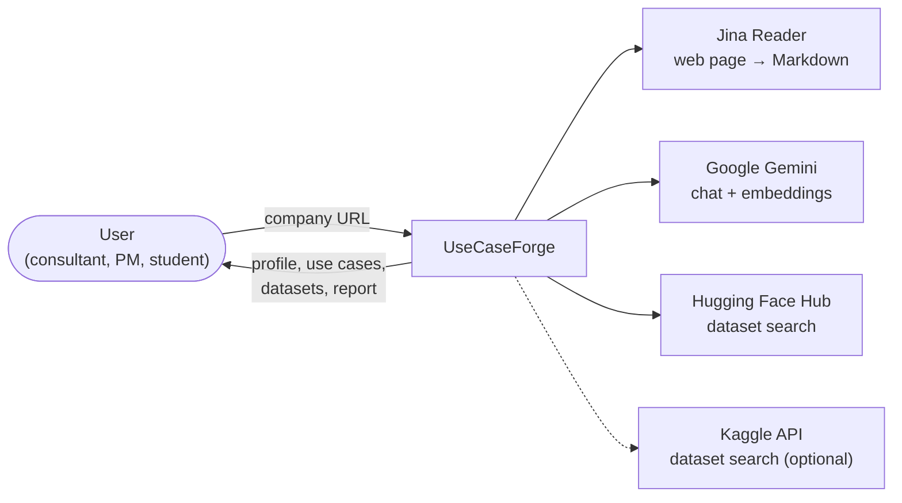
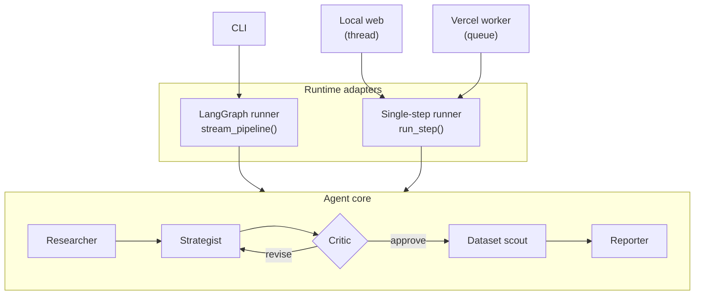
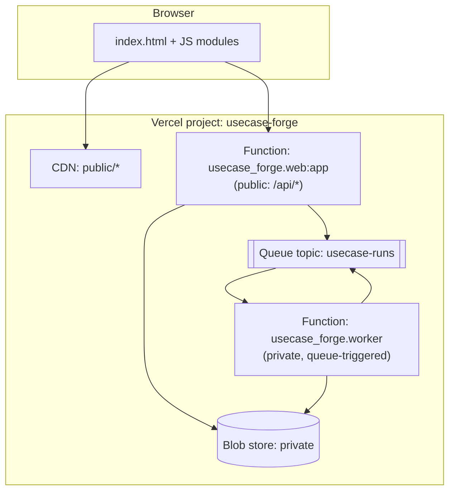

# High-Level Design: UseCaseForge

| | |
|---|---|
| **Document** | High-Level Design (HLD) |
| **System** | UseCaseForge: multi-agent GenAI use-case generator |
| **Version** | 1.0 |
| **Companion** | [LLD.md](LLD.md) (module-level design) |

---

## 1. Purpose

UseCaseForge takes a company's website and produces **grounded, company-specific Generative AI / ML use cases**, each with evidence from the website and public datasets to prototype it. It replaces a manual process (reading the site, brainstorming, checking ideas, searching for data) that takes an analyst several hours.

### 1.1 Goals

| ID | Goal |
|---|---|
| G1 | Use cases must be **specific** to the company, not generic |
| G2 | Every use case must be **traceable** to passages on the company's site |
| G3 | Quality must be **checked automatically**, with weak plans revised |
| G4 | Each use case should come with **real public datasets** for a prototype |
| G5 | Run as a **public web app** on serverless infrastructure, with live progress |
| G6 | Be **testable offline** and cheap to run (free-tier LLM) |

### 1.2 Non-goals

- Reading sources other than the given pages (news, filings, industry reports).
- Building or training the proposed models.
- User accounts or long-term history (runs are shared by link).

---

## 2. System context

| External system | Used for | Auth | Failure handling |
|---|---|---|---|
| Jina Reader | Fetching any page (including JS-rendered) as Markdown | Optional key | Permanent failure with a clear message |
| Google Gemini | Structured generation (4 agents) and embeddings | API key (server or visitor) | Model fallback, then queue retry with backoff |
| Hugging Face Hub | Dataset search by name | None | Fail soft: skipped |
| Kaggle | Dataset search | Optional token | Fail soft: skipped |

---

## 3. Architecture overview

The system has two layers.

1. **Agent core** (framework-independent Python): five agents that read and update a shared, typed `PipelineState`. Control flow is defined once in `graph.py`.
2. **Runtime adapters** that execute the core:
   - **In-process** (LangGraph `StateGraph`) for the CLI, local development and tests.
   - **Serverless** (Vercel Queues + Blob) for production: one agent step per queue message.

---

## 4. Components

| Component | Responsibility | Technology |
|---|---|---|
| **Web UI** | Collects input, shows live progress for each agent, renders results, downloads and share links | Vanilla JS (ES modules), CSS |
| **API** | Validates requests, enforces quota and rate limits, creates runs, serves progress | FastAPI on a Vercel Function |
| **Queue** | Delivers "run step X of run Y" messages at least once, with retries | Vercel Queues |
| **Worker** | Runs exactly one agent per message, persists state, queues the next step | Python, Vercel queue-triggered function |
| **Run store** | Immutable JSON snapshots per step; daily quota counters | Vercel Blob (private) |
| **Agent core** | Five agents, prompts, routing, schemas | LangChain Core, LangGraph, Pydantic |
| **Retrieval** | Chunking, embeddings, similarity search, source IDs | `InMemoryVectorStore`, Gemini embeddings |
| **Tools** | Page fetching and cleaning; dataset search | Jina Reader, `huggingface_hub`, `kaggle` |
| **Key vault** | Encrypts visitors' own API keys in transit | Fernet (`cryptography`) |

---

## 5. Deployment view

- **Region:** `iad1` (functions and Blob in the same region).
- **Build:** `uv` installs dependencies from `pyproject.toml`; Python 3.12.
- **Config:** environment variables only (see the README).
- **Alternative:** Docker image running the same FastAPI app with in-memory storage and thread dispatch.

---

## 6. Key flows

### 6.1 Create a run

1. The UI sends `POST /api/runs {url, extra_urls?, api_key?}`.
2. The API validates the URL (blocking SSRF targets), applies the per-IP rate limit and, for the shared key, the daily quota.
3. The API writes snapshot `seq=0` (status `queued`, step `researcher`) and records a quota marker.
4. The API sends queue message `{run_id, step: researcher, seq: 0, key?: <encrypted>}` and returns `202 {id}`.

### 6.2 Execute a step (repeats until done)

1. The worker receives a message and loads the latest snapshot.
2. If `seq`, `step` or status don't match, the message is a duplicate or stale: acknowledge it and stop.
3. Run the agent with the run's key (decrypted in memory only).
4. On success: write snapshot `seq+1`, then send a message for the next step (or mark `succeeded`).
5. On a transient error: write a notice and let the queue redeliver after a backoff.
6. On a permanent error: mark the run `failed` with a user-facing message.

### 6.3 Show progress

The UI polls `GET /api/runs/{id}` every 2.5 seconds (every 5 seconds after the first minute). The API returns a **public view** that excludes keys and raw page text.

---

## 7. Quality attributes

| Attribute | Approach |
|---|---|
| **Reliability** | At-least-once queue, idempotent steps, model fallback, exponential backoff, per-step persistence |
| **Scalability** | Stateless functions; runs are independent; storage is per-run objects |
| **Performance** | UI is static on the CDN; the API answers in milliseconds; total run time is bound by LLM latency |
| **Security** | SSRF validation, CSP, `textContent` rendering, encrypted keys, unguessable IDs, rate limit and quota |
| **Testability** | All I/O is injected via `Dependencies`; 42 offline tests; demo mode |
| **Cost** | Free-tier Gemini; daily cap on the shared key; visitors can bring their own key |
| **Observability** | Step log shown in the UI; structured logs in Vercel; immutable audit trail per run |

---

## 8. Risks and mitigations

| Risk | Impact | Mitigation |
|---|---|---|
| LLM free-tier quota exhausted | Runs fail | Daily cap, bring-your-own-key, clear error message |
| Model retired or renamed | Every run fails | Model names are configuration; a fallback model is configured |
| Generic or hallucinated output | Low value | RAG grounding, citation validation in code, critic rubric |
| Site blocks scraping or has little text | Weak profile | Clear failure; option to add About/Products pages |
| Queue redelivery | Duplicate work | `seq` check makes steps idempotent |
| Abuse of the public endpoint | Cost | Rate limit, quota, input validation |

---

## 9. Evolution from v0

The original prototype ran three scripts in sequence through `subprocess`, passing text files between them, with no retrieval, validation or tests. v1 keeps the same idea (scrape → generate → find data) and turns it into a real multi-agent system with a review loop, grounding, typed outputs, a production deployment and a test suite. See the [README project history](../README.md#-project-history).
