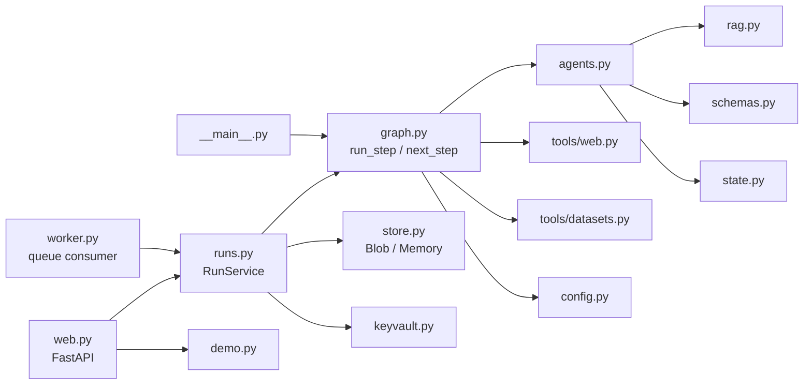
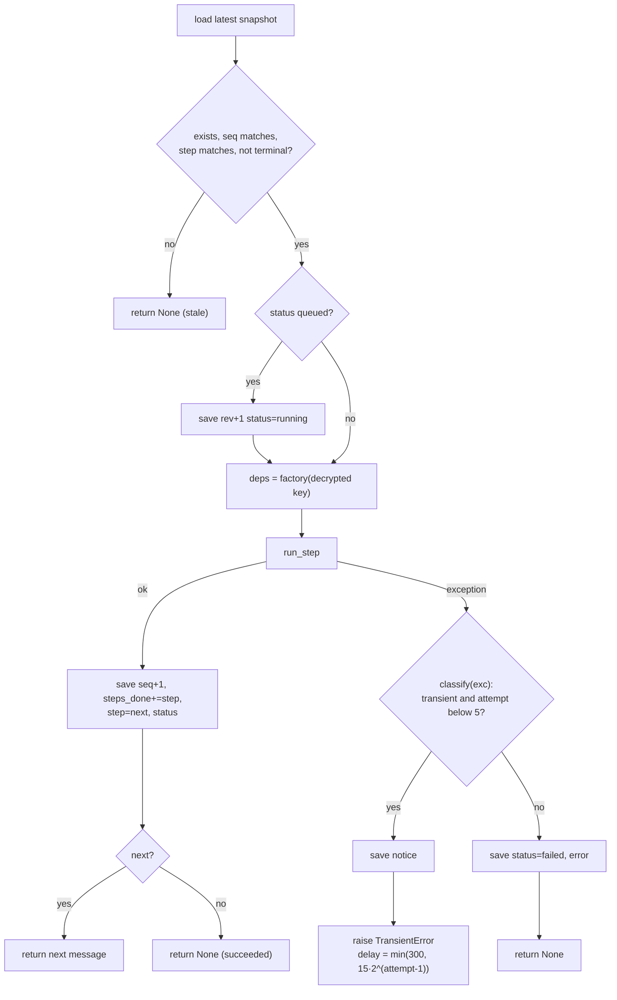

# Low-Level Design: UseCaseForge

| | |
|---|---|
| **Document** | Low-Level Design (LLD) |
| **Version** | 1.0 |
| **Companion** | [HLD.md](HLD.md) |

This document describes each module, its main functions, data structures and algorithms.

---

## 1. Module map



| Module | Main symbols |
|---|---|
| `config.py` | `Settings` (frozen dataclass), `load_settings()` |
| `schemas.py` | `CompanyProfile`, `UseCase`, `UseCasePlan`, `Critique`, `DatasetCandidate`, `DatasetVerdict`, `DatasetJudgement`, `RecommendedDataset`, `UseCaseResult`, `Source` |
| `state.py` | `PipelineState` (TypedDict), `apply_update`, `dump_state`, `load_state`, `Dependencies` |
| `rag.py` | `chunk_text`, `KnowledgeBase`, `format_context` |
| `agents.py` | `researcher`, `strategist`, `critic`, `after_critic`, `dataset_scout`, `reporter` |
| `graph.py` | `STEPS`, `next_step`, `run_step`, `build_graph`, `FallbackChatModel`, `default_dependencies`, `stream_pipeline`, `run_pipeline` |
| `runs.py` | `RunService`, `validate_url`, `classify`, `public_view`, `InputError`, `QuotaExceeded`, `TransientError` |
| `store.py` | `RunStore` protocol, `MemoryRunStore`, `BlobRunStore` |
| `keyvault.py` | `KeyVault.seal / open / ephemeral` |
| `web.py` | `app`, `get_service`, `dispatch`, rate limiter, routes |
| `worker.py` | `process_step` (`@subscribe`) |
| `tools/web.py` | `fetch_page`, `clean_markdown`, `ScrapeError` |
| `tools/datasets.py` | `search_huggingface`, `search_kaggle`, `keyword_variants`, `search_datasets` |

---

## 2. Pipeline state

```python
class PipelineState(TypedDict, total=False):
    url: str
    extra_urls: list[str]
    profile: CompanyProfile
    sources: list[Source]            # retrieved once by the researcher
    plan: UseCasePlan
    critique: Critique
    revisions: int                   # number of rejections so far
    scores: Annotated[list[int], operator.add]   # appended each critic round
    results: list[UseCaseResult]
    report: str
    log: Annotated[list[str], operator.add]      # appended by every agent
```

- **Merge rule** (`apply_update`): keys in `APPEND_KEYS = {"scores", "log"}` are concatenated; every other key is replaced. This mirrors LangGraph's reducers so both runners behave the same.
- **Serialisation** (`dump_state` / `load_state`): a `TypeAdapter` per typed key converts Pydantic models to and from JSON, so a state can be stored between serverless invocations.

---

## 3. Agents

Every agent has the signature `agent(state: PipelineState, deps: Dependencies) -> dict` and returns **only the keys it changes**. LLM calls go through:

```python
def _ask(deps, schema, system, human):
    return deps.llm.with_structured_output(schema).invoke([("system", system), ("human", human)])
```

### 3.1 Researcher

```text
kb = KnowledgeBase(deps.embeddings)
for url in [url, *extra_urls]:
    text = deps.fetch_page(url)          # cleaned Markdown
    kb.add_page(url, text)               # chunks → S1..Sn
corpus  = join(pages)[:12_000]
profile = ask(CompanyProfile, RESEARCHER_SYSTEM, corpus)
queries = [summary, products[:4], pain_points[:4], "name customers ..."]
sources = kb.retrieve(queries, k=3)      # de-duplicated, first-seen order
return {profile, sources, log}
```

### 3.2 Strategist

- Prompt = profile JSON + `format_context(sources)` (`[S#] (url)\ntext`).
- On a revision, it also gets the previous score, the critic's feedback, the list of problems and the previous plan.
- Rules in the system prompt: 4-5 use cases, at least 3 departments, a concrete technique plus the data needed, a KPI, and 1-3 word dataset keywords without filler words.
- **Post-processing:** `evidence` keeps only IDs that are in `{s.id for s in sources}`, with brackets stripped.

### 3.3 Critic

- Rubric: specificity (most important), grounding, feasibility, coverage, impact. Generic plans must score 6 or less.
- `score` is clamped to 1-10 in code.
- `revisions += 1` only when the plan is rejected.

```python
def after_critic(state, deps):
    if state["critique"].score >= settings.approval_score: return "dataset_scout"
    if state["revisions"] > settings.max_revisions:        return "dataset_scout"
    return "strategist"
```

With `max_revisions = 2`, the strategist runs at most 3 times.

### 3.4 Dataset scout

```text
for uc in plan.use_cases:
    candidates = {}                                # url → candidate (de-duplicated)
    for kw in uc.dataset_keywords[:4]:
        for c in deps.search_datasets(kw): candidates.setdefault(c.url, c)
    if candidates:
        verdicts = ask(DatasetJudgement, SCOUT_SYSTEM, use case + candidate list)
        chosen = [candidates[v.url] + reason for v in verdicts if v.relevant and v.url in candidates]
    keep top `datasets_per_use_case` by downloads
```

The relevance rule accepts datasets that fit the **task** even from another industry, and rejects lead or contact lists for sale, unrelated benchmarks and opaque names.

### 3.5 Reporter

Pure code. Builds Markdown: header (industry, source, score rounds), summary, a section per use case (department, objective, approach, impact, evidence, datasets), and a **Sources** list that contains only cited IDs.

---

## 4. Control flow (`graph.py`)

```python
STEPS = ("researcher", "strategist", "critic", "dataset_scout", "reporter")

def next_step(step, state, deps):
    if step == "critic": return agents.after_critic(state, deps)
    return {"researcher": "strategist", "strategist": "critic",
            "dataset_scout": "reporter"}.get(step)        # reporter → None

def run_step(step, state, deps):
    update = getattr(agents, step)(state, deps)
    new_state = apply_update(state, update)
    return new_state, next_step(step, new_state, deps)
```

`build_graph` adds every step as a LangGraph node, with a conditional edge whose path function is `next_step(...) or END`. Both runners therefore share a single definition of the routing.

**Model fallback:**

```python
class FallbackChatModel:
    def with_structured_output(self, schema):
        primary, *rest = [m.with_structured_output(schema) for m in self.models]
        return primary.with_fallbacks(rest) if rest else primary
```

Each `ChatGoogleGenerativeAI` uses `max_retries=2` so an overloaded model hands over to the fallback quickly.

---

## 5. Retrieval (`rag.py`)

### 5.1 Chunking

```text
paragraphs = split on blank lines
for p in paragraphs:
    while len(p) > size:                  # hard-split very long paragraphs
        emit p[:size]; p = p[size-overlap:]
    if current + p would exceed size:
        emit current; current = current[-overlap:] + p    # overlap carries context
    else: current += p
emit current
```

Defaults: `size=900`, `overlap=150`.

### 5.2 Knowledge base

- `add_page(url, text)` gives each chunk a stable ID `S{n}` (sequential across pages) and stores a `Source(id, url, excerpt)`.
- `retrieve(queries, k)` runs a similarity search per query and de-duplicates by ID in first-seen order.

---

## 6. Tools

### 6.1 Page fetching (`tools/web.py`)

1. `GET https://r.jina.ai/<url>` with an optional bearer key and a 60-second timeout.
2. `clean_markdown`: remove ``, replace `[text](url)` with `text`, remove bare URLs, collapse whitespace, drop lines without word characters, and limit consecutive blank lines to one.
3. Fewer than 200 characters after cleaning raises `ScrapeError`.

### 6.2 Dataset search (`tools/datasets.py`)

```python
FILLER_WORDS = {"dataset", "datasets", "data", "logs", "log", "records", "corpus"}

def keyword_variants(kw):
    words = [w for w in kw.lower().split() if w not in FILLER_WORDS]
    return [" ".join(words)] + (two-word windows if len(words) > 2 else [])
```

For each source (Hugging Face, then Kaggle), try the variants in order and **stop at the first one with hits**. Any exception, including Kaggle's `SystemExit` on bad credentials, is logged and treated as no results. Kaggle is imported lazily, with stdout suppressed, only when credentials exist.

---

## 7. Web run lifecycle (`runs.py`)

### 7.1 Snapshot

| Field | Meaning |
|---|---|
| `id` | `uuid4().hex` (32 hex characters) |
| `seq` | Number of completed steps; the message expects this exact value |
| `rev` | Revision within a step (status change, notice) |
| `status` | `queued` → `running` → `succeeded` or `failed` |
| `step` | Next step to run (`None` when finished) |
| `steps_done` | Ordered list of completed steps (may repeat strategist and critic) |
| `key_source` | `server` or `own` |
| `notice` / `error` | User-facing messages |
| `state` | `dump_state(PipelineState)` |

Storage path: `runs/{id}/{seq:04d}.{rev:03d}.json`. The latest snapshot is the maximum path name.

### 7.2 `create(url, extra_urls, api_key)`

1. `validate_url` on every URL (add `https://` if missing; reject non-http(s), hosts without a dot, `localhost`, `.local`, `.internal`, `.localhost`, and non-global IP literals).
2. At most 3 extra pages.
3. With an own key: require a vault and the key format `[A-Za-z0-9_-]{20,200}`. Without one: require a server key and quota left, otherwise raise `QuotaExceeded`.
4. Save snapshot `seq=0`; for shared-key runs, record `quota/{YYYY-MM-DD}/{id}`.
5. Return `(snapshot, message)`; the message carries `key = vault.seal(api_key)` when there is one.

### 7.3 `execute(message, attempt)`



### 7.4 Error classification

| Match | Transient? | Message |
|---|---|---|
| `ScrapeError` | No | "Couldn't read the website. …" |
| `MissingApiKeyError` | No | Original message |
| `API_KEY_INVALID` / "API key not valid" | No | "Gemini rejected the API key…" |
| `RESOURCE_EXHAUSTED` and `PerDay` | No | "…daily quota is used up… use your own key" |
| `RESOURCE_EXHAUSTED`, `UNAVAILABLE`, `503`, `429`, `DEADLINE_EXCEEDED` | **Yes** | "Gemini is busy right now. Retrying automatically…" |
| anything else | No | "The pipeline stopped unexpectedly (ExceptionType)." |

### 7.5 Public view

Returns `id, status, step, steps_done, key_source, created_at, updated_at, notice, error, url, profile, scores, critique, results, sources, report, log`. It **never** returns the message key, the raw `state` object or page text beyond the cited excerpts.

---

## 8. Storage (`store.py`)

```python
class RunStore(Protocol):
    def save(self, snapshot: dict) -> None: ...
    def latest(self, run_id: str) -> dict | None: ...
    def record_server_run(self, run_id: str) -> None: ...
    def server_runs_today(self) -> int: ...
```

| Implementation | `save` | `latest` | Quota |
|---|---|---|---|
| `MemoryRunStore` | dict under a lock | max key with the prefix | count of `quota/{today}/` keys |
| `BlobRunStore` | `put_blob(path, json, access="private")` | `query_blobs(prefix)` → max → `get_blob` | `query_blobs("quota/{today}/")` |

---

## 9. HTTP layer (`web.py`)

| Concern | Implementation |
|---|---|
| Service wiring | `get_service()` (cached): Blob store if `BLOB_READ_WRITE_TOKEN` is set, else memory (and a `ConfigError` → `503` on Vercel); `KeyVault(RUN_SECRET)`, or a per-process ephemeral vault locally; demo dependencies if `DEMO_MODE=1` |
| Dispatch | On Vercel: `await vercel.queue.send("usecase-runs", msg)`. Locally: a `ThreadPoolExecutor` runs steps back to back and sleeps on `TransientError` |
| Rate limit | Per-IP sliding window: 5 requests per 60 seconds (per instance) |
| Headers | CSP, nosniff and Referrer-Policy on every response; `Cache-Control: no-store` on `/api/*` |
| Static files | Mounted from `public/` only when not on Vercel (the CDN serves them in production) |

**Worker (`worker.py`):**

```python
@subscribe(topic="usecase-runs")
async def process_step(message: Message[dict[str, object]]) -> None:
    try:
        follow = await asyncio.to_thread(service.execute, message.payload, message.metadata.delivery_count)
    except TransientError as exc:
        raise RetryAfter(exc.delay) from exc
    if follow:
        await send("usecase-runs", follow)
```

---

## 10. Front end (`public/`)

| File | Responsibility |
|---|---|
| `js/dom.js` | `el(tag, attrs, ...children)`: a safe DOM builder (text via `textContent`, styles via CSSOM); `toast`, `download`, `formatNumber` |
| `js/api.js` | `api.status / createRun / getRun`; turns network errors and non-2xx responses into `ApiError(message, status)` |
| `js/render.js` | Pure renderers: step tracker, skeleton, error panel, score, use cases, evidence buttons, datasets, sources |
| `app.js` | Controller: form validation, example buttons, submit → `pushState(?run=id)`, polling (2.5s, then 5s), finish/retry, downloads, copy link |

**UI states:** idle (intro), submitting, running (tracker + skeleton + notices), failed (error panel + retry), succeeded (results), and a deep link (`?run=` resumes polling).

**Accessibility:** skip link, labelled inputs, `aria-invalid` / `aria-describedby` for errors, `aria-live` regions, hidden state text in the step tracker for screen readers, `aria-expanded` / `aria-controls` on evidence buttons, focus moved to the results heading, `prefers-reduced-motion` support, dark mode via `prefers-color-scheme`.

---

## 11. Configuration

`Settings` (from the environment): `chat_model`, `fallback_model`, `embedding_model`, `google_api_key`, `jina_api_key`, `approval_score=7`, `max_revisions=2`, `datasets_per_use_case=3`. Web-only: `RUN_SECRET`, `DAILY_RUN_LIMIT=3`, `BLOB_READ_WRITE_TOKEN`, `DEMO_MODE`, `VERCEL`.

---

## 12. Test design

| Technique | Where |
|---|---|
| **Fake LLM** with per-schema answer queues and a prompt log | `tests/conftest.py::FakeLLM` |
| **Deterministic embeddings** | `DeterministicFakeEmbedding(size=32)` |
| **Injected fetch and search** | `make_deps(llm, fetch=..., search=...)` |
| **Demo agents** that run the critic loop (5 → 8) | `usecase_forge/demo.py` |
| **HTTP tests** in local mode | `TestClient` + `DEMO_MODE=1` + zero delay |

Key cases: the revision loop carries feedback forward; the revision budget stops the loop; invalid citations are removed; datasets are filtered and capped; search failures fail soft; duplicate deliveries are skipped; transient vs permanent errors; daily quota applies only to the shared key; the own key never appears in snapshots; 7 SSRF URL cases; rate limit returns 429.
